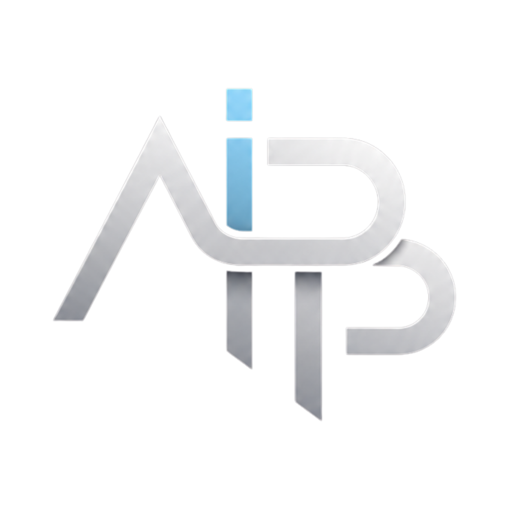
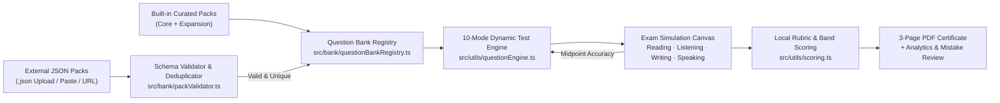

<div align="center">

<!-- Animated Institutional Hero Banner -->


<br />
<br />



# AIPP TOEFL TEAM (`AIPProject03`)

**TOEFL iBT Simulation & Learning Platform**  
*“Practice Smarter. Perform Better. Reach Your Target.”*

<p align="center">
  
  
  
  
  
</p>

<br />

<!-- Sleek Clickable GitHub Navigation Bar -->
<table>
  <tr>
    <td align="center">
      <a href="#ui-preview">
        
      </a>
      <a href="#key-features">
        
      </a>
      <a href="#question-bank">
        
      </a>
      <a href="#backup-restore">
        
      </a>
      <a href="#tech-stack">
        
      </a>
      <a href="#architecture">
        
      </a>
      <a href="#json-packs">
        
      </a>
      <a href="#getting-started">
        
      </a>
    </td>
  </tr>
</table>

</div>

---

## 📖 Overview

**AIPP TOEFL TEAM (`AIPProject03`)** is a standalone, production-grade **TOEFL iBT (January 2026 Format)** preparation and exam simulation web application designed for international students, university & scholarship applicants, and English learners.

Built with **zero external AI subscriptions or paywalled API dependencies**, the entire platform runs reliably in the browser with local persistence (`localStorage`), real-time adaptive routing, Web Speech synthesis & voice recording, deterministic rubric scoring, SM-2 spaced repetition vocabulary training, downloadable 3-page PDF score certificates, and an **expandable JSON Question Pack system** so educators and learners can scale the bank indefinitely without touching source code.

---

<a id="ui-preview"></a>
## 🖥️ UI Preview

<div align="center">
  
  <br />
  <sub><b>Responsive Institutional SaaS Interface</b> — Distraction-free exam environment, Light &amp; Dark themes, adaptive progress rings, interactive charts, and ergonomic mobile bottom navigation.</sub>
</div>

---

<a id="key-features"></a>
## ✨ Key Features

<table>
  <tr>
    <td width="50%" valign="top">
      <h3>🎯 10-Mode Dynamic Test Generator</h3>
      <ul>
        <li><b>Full 2026 Blueprint (~120 items)</b> &amp; <b>Express Drill</b> presets (<code>50 Reading · 47 Listening · 12 Writing · 11 Speaking</code>)</li>
        <li><b>Adaptive Full Test</b> with real-time Stage 1 → Stage 2 difficulty routing in Reading &amp; Listening</li>
        <li><b>Standard Full</b> &amp; <b>Random Full</b> avoiding repeats across consecutive tests (450-item recency window)</li>
        <li><b>Single-Section Modes</b>: Reading, Listening, Writing, Speaking</li>
        <li><b>Weakness-Based Practice</b>, <b>Mistake Review</b>, and <b>Custom Practice Builder</b></li>
      </ul>
    </td>
    <td width="50%" valign="top">
      <h3>📚 All 12 Updated 2026 TOEFL iBT Task Types</h3>
      <ul>
        <li><b>Reading:</b> Complete the Words, Read in Daily Life, Read an Academic Passage</li>
        <li><b>Listening:</b> Listen &amp; Choose a Response, Conversations, Announcements, Academic Talks (multi-voice audio synthesis)</li>
        <li><b>Writing:</b> Build a Sentence (interactive word-order puzzles), Write an Email, Write for an Academic Discussion</li>
        <li><b>Speaking:</b> Listen and Repeat, Take an Interview (45s mic recording + transcript fallback)</li>
      </ul>
    </td>
  </tr>
  <tr>
    <td width="50%" valign="top">
      <h3>📊 Scoring Engine &amp; 3-Page PDF Certificate</h3>
      <ul>
        <li>Updated <b>1.0–6.0 half-point Band Scale</b> mapped to <b>CEFR (A2–C2)</b> and legacy 0–120 reference</li>
        <li>Strict Exam Mode (single-play audio, hidden transcripts, active timer) &amp; Guided Practice Mode (hints, pause, instant feedback)</li>
        <li>Downloadable <b>3-Page Institutional PDF Score Report</b> via <code>jsPDF</code> featuring QR verification code, section breakdowns, rubric feedback, and Founder signature</li>
      </ul>
    </td>
    <td width="50%" valign="top">
      <h3>🧠 Vocabulary, Backup &amp; JSON Expansion</h3>
      <ul>
        <li><b>SM-2 Spaced Repetition</b> flashcards, randomized 10-word quizzes, audio pronunciation, and daily-rotating <b>Word of the Day</b> across all 250+ active words</li>
        <li><b>Performance Analytics</b> with multi-line section trends, task-type mastery charts, and one-click Mistake Remediation</li>
        <li><b>1-Click Export &amp; Import Study Backup (JSON)</b> in Settings to safeguard progress or transfer across devices (laptop ↔ mobile)</li>
        <li><b>JSON Question Pack Manager</b> with schema validation, semver upgrade tracking, duplicate ID detection, and normalized content fingerprinting</li>
      </ul>
    </td>
  </tr>
</table>

---

<a id="question-bank"></a>
## 📦 Question Bank & JSON Expansion

The platform ships with a genuinely original, zero-duplicate curated dataset and transparently tracks active coverage toward long-term institutional expansion targets inside **Question Bank & Packs**:

| Skill / Category | Built-in Active Bank | + 2 Official Sample JSON Packs | Long-Term Target | Expansion Method |
| :--- | :---: | :---: | :---: | :--- |
| **Reading** | **106 scored items** *(68 sets)* | **116 scored items** *(74 sets)* | 500 items | Import `.json` packs |
| **Listening** | **60 audio items** | **66 audio items** | 500 items | Import `.json` packs |
| **Writing** | **56 prompts** | **62 prompts** | 300 prompts | Import `.json` packs |
| **Speaking** | **56 prompts** | **62 prompts** | 300 prompts | Import `.json` packs |
| **Academic Vocabulary** | **250 entries** | **285 entries** | 1,000 entries | Import `.json` packs |

> **Ready-to-Test External Packs Included in `public/question-packs/`:**
> - `aipp-stem-reading-listening-v1.json` — 12 STEM Reading & Listening exercises (16 scored items) + 20 STEM vocabulary entries
> - `aipp-academic-writing-speaking-v1.json` — 12 Writing & Speaking prompts + 15 academic discourse vocabulary entries

---

<a id="backup-restore"></a>
## 💾 Data Persistence, Backup & Device Transfer

All progress is **saved automatically in your browser's built-in storage (`localStorage`)** — no sign-up, no server account, and no subscription required.

| Capability | How It Works |
| :--- | :--- |
| **Automatic Local Saving** | Profile, certificate name, test history, band scores, mistake logs, autosaved unfinished exam drafts, SM-2 vocabulary deck, XP, streaks, study plan, achievements, and imported JSON question packs persist automatically in your browser. |
| **Export Study Backup (JSON)** | Go to **Settings → Data Persistence, Backup & Device Transfer → `Export Study Backup (JSON)`** to download a single `.json` snapshot containing **all your progress + any imported question packs**. |
| **Import / Restore Backup (JSON)** | On a new device (e.g., transferring from laptop to phone) or after clearing browser cache, click **`Import / Restore Backup (JSON)`** in **Settings** to validate and restore your complete study history instantly. |

> 💡 **Tip for Users:** Browser `localStorage` is scoped to the specific device, browser profile, and site URL (it does not sync automatically via Chrome Sync). Exporting a quick backup `.json` file makes moving between devices effortless and protects against accidental browser cache clears.

---

<a id="tech-stack"></a>
## 🛠️ Tech Stack

<div align="center">
  <a href="https://skillicons.dev">
    
  </a>
</div>

<br />

<div align="center">
  
  
  
  
  
  
  
  
</div>

| Layer | Technology | Purpose |
| :--- | :--- | :--- |
| **Core Framework** | React 19 + TypeScript + Vite 8 | Fast, strictly typed Single Page Application |
| **Styling & Design** | Tailwind CSS v4 + Lucide Icons | Institutional Light/Dark themes & mobile-first layout |
| **Animations** | `motion` (Framer Motion) | Subtle progress rings, page transitions & unlock toasts |
| **Data Visualization** | `recharts` | Multi-line band progression & task-type mastery charts |
| **PDF & Verification** | `jspdf` + `qrcode` | Client-side 3-page institutional score certificate export |
| **Audio & Speech** | Web Speech API + MediaRecorder | Multi-voice Listening playback & Speaking mic recording |
| **Persistence** | Browser `localStorage` | Autosaved exam drafts, attempt history, SM-2 & JSON packs |

---

<a id="architecture"></a>
## 🏗️ Architecture



---

## 📂 Project Structure

```text
├── docs/
│   ├── banner.svg                     # Animated GitHub README hero banner
│   └── ui-mockup.svg                  # Desktop & mobile UI mockup illustration
├── public/
│   ├── assets/aistudio/               # Brand logo & founder signature assets
│   └── question-packs/                # Official downloadable JSON expansion packs
│       ├── aipp-stem-reading-listening-v1.json
│       └── aipp-academic-writing-speaking-v1.json
├── src/
│   ├── bank/
│   │   ├── packValidator.ts           # JSON schema v1.0 validator, semver & deduplication
│   │   └── questionBankRegistry.ts    # Reactive registry merging built-in & imported packs
│   ├── components/
│   │   ├── exam/                      # Reading, Listening, Writing & Speaking task views
│   │   ├── ui/MotionPrimitives.tsx    # ScoreRing, CountUpValue, AnimatedProgressBar
│   │   ├── BrandLogo.tsx              # Consistent AIPP TOEFL TEAM identity component
│   │   ├── CertificateCard.tsx        # Certificate preview & 3-page PDF trigger
│   │   └── Layout.tsx                 # Responsive desktop sidebar + mobile tab bar
│   ├── context/AppContext.tsx         # Persistent user state, XP, SM-2 & bank reactivity
│   ├── data/
│   │   ├── readingBank.ts             # Core curated Reading bank
│   │   ├── listeningBank.ts           # Core curated Listening bank
│   │   ├── writingBank.ts             # Core curated Writing bank
│   │   ├── speakingBank.ts            # Core curated Speaking bank
│   │   ├── vocabularyBank.ts          # Core academic vocabulary bank
│   │   └── packs/                     # Curated expansion packs (168 sets + 214 vocab)
│   ├── pages/
│   │   ├── DashboardPage.tsx          # Readiness overview, KPIs & quick launch
│   │   ├── ExamSimulationPage.tsx     # 10-mode generator, adaptive test & score reveal
│   │   ├── PracticeCenterPage.tsx     # Focused drill packs & paginated exercise library
│   │   ├── QuestionBankPage.tsx       # Coverage dashboard & JSON pack importer
│   │   ├── VocabularyPage.tsx         # Word of the Day, SM-2 flashcards & quiz mode
│   │   ├── AnalyticsPage.tsx          # Score trends, task mastery & mistake analysis
│   │   ├── StudyGuidePage.tsx         # Built-in grammar, writing & speaking frameworks
│   │   ├── StudyPlanPage.tsx          # Weekly schedule & target band roadmap
│   │   ├── HistoryPage.tsx            # Past simulations & PDF certificate re-download
│   │   ├── AchievementsPage.tsx       # Gamified badges, levels & streaks
│   │   └── SettingsPage.tsx           # Profile, theme, preferences & JSON backup/restore
│   ├── types/toefl.ts                 # Complete TypeScript models for 2026 format
│   └── utils/
│       ├── audio.ts                   # Multi-voice Web Speech synthesizer & chimes
│       ├── pdfGenerator.ts            # 3-page institutional PDF certificate builder
│       ├── questionEngine.ts          # 10-mode dynamic generator & Stage 2 routing
│       └── scoring.ts                 # 1.0–6.0 Band, CEFR & local rubric evaluators
├── index.html
├── package.json
└── tsconfig.json
```

---

<a id="getting-started"></a>
## 🚀 Getting Started

### Prerequisites
- **Node.js** `v18+` (recommended `v20+` or `v22+`)
- **npm** `v9+`

### Local Installation & Run

```bash
# 1. Clone the repository
git clone https://github.com/<your-username>/<your-repo-name>.git
cd <your-repo-name>

# 2. Install dependencies
npm install

# 3. Start the development server (runs on http://localhost:3000)
npm run dev
```

### Available Scripts

| Command | Description |
| :--- | :--- |
| `npm run dev` | Starts Vite development server on port `3000` |
| `npm run build` | Builds the optimized production bundle into `dist/` |
| `npm run preview` | Previews the production build locally on port `3000` |
| `npm run lint` | Runs strict TypeScript type-checking (`tsc --noEmit`) |

---

<a id="json-packs"></a>
## 🧩 JSON Pack Schema

You can expand your question bank at any time from **Question Bank & Packs** without editing application code. Download the starter template directly inside the app or follow `schemaVersion: "1.0"`:

```json
{
  "schemaVersion": "1.0",
  "manifest": {
    "packId": "custom-toefl-pack-01",
    "name": "Custom TOEFL 2026 Question Pack",
    "version": "1.0.0",
    "description": "Additional Reading, Listening, Writing, Speaking & Vocabulary items.",
    "author": "AIPP TOEFL TEAM",
    "createdAt": "2026-03-01T00:00:00.000Z",
    "source": "imported",
    "tags": ["Custom", "2026 Format"]
  },
  "questions": [],
  "vocabulary": []
}
```

The built-in validator automatically verifies:
1. All 12 TOEFL 2026 task schemas and answer key boundaries
2. Semantic version tracking (`new`, `upgrade`, or `same-or-older`)
3. Cross-bank and intra-file **Duplicate ID Detection**
4. Normalized **Duplicate Content Fingerprinting**

---

## ⚖️ Disclaimer & Attribution

> **Independent Educational Platform:**  
> **AIPP TOEFL TEAM (`AIPProject03`)** is an independent educational simulation and self-study platform aligned with the updated 2026 TOEFL iBT structure. It is **not affiliated with, endorsed by, or officially connected to ETS (Educational Testing Service)**. All generated scores and PDF certificates represent independent simulation estimates for learning purposes only.

<div align="center">

---

Built with precision by **AIPP TOEFL TEAM (`AIPProject03`)**  
Founder: **A. Irwin Putra Pangesti, S.T.**

*Practice Smarter. Perform Better. Reach Your Target.*

</div>